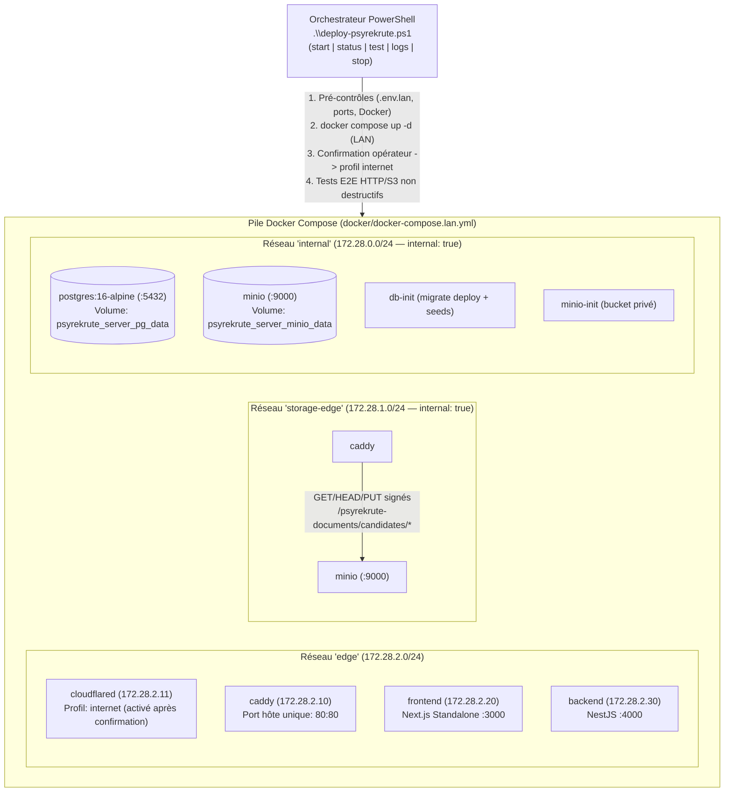

# AUDIT ET CONCEPTION DE L'ORCHESTRATEUR DE DÉPLOIEMENT AUTOMATISÉ — PSYREKRUTE

**Projet :** PsyRekrute (Monolithe modulaire — Next.js 14 / NestJS 10 / Prisma 5.14 / PostgreSQL 16 / MinIO / Caddy / Cloudflare Tunnel)  
**Référence architecturale :** DCTF v3.1.2 (`docs/cahier_des_charges_et_conception.md`) & Plan LAN + Internet (`docs/plan_deploiement_lan_internet.md`, Sections 1 à 15)  
**Branche et commit audités :** `feat/sprints4-5-pre-lan` (`9b4259049944a7320176969c0c633d86be04ef7d`)  
**Environnement cible :** Windows 10/11 + PowerShell 5.1 / 7+ + Docker Desktop (WSL2)  
**Date :** 19 novembre 2026  
**Mode d'exécution :** Lecture seule stricte (aucun fichier source, Dockerfile, Docker Compose, `.env` ou script créé/modifié ; aucun conteneur ni service démarré).

---

## 1. Fichiers réellement examinés (Phase 1)

| Catégorie | Fichiers inspectés dans le dépôt | Constat principal |
|---|---|---|
| **Docker & Reverse Proxy** | `docker/docker-compose.yml`<br>`docker/docker-compose.prod.yml`<br>`docker/nginx/nginx.conf`<br>`docker/nginx/conf.d/psyrekrute.conf`<br>`backend/Dockerfile`, `backend/Dockerfile.prod`<br>`frontend/Dockerfile`, `frontend/Dockerfile.prod`<br>`backend/.dockerignore`, `frontend/.dockerignore` | `Dockerfile.prod` backend (`CMD ["node", "dist/src/main.js"]`) et frontend (`output: 'standalone'`, `NEXT_PUBLIC_API_URL=/api/v1`) sont prêts. `docker-compose.lan.yml` et `docker/caddy/Caddyfile` sont spécifiés et validés en Section 14–15 de `docs/plan_deploiement_lan_internet.md` mais pas encore créés sur disque (`ANOM-01`). |
| **Backend NestJS & Sécurité** | `backend/src/main.ts`<br>`backend/src/modules/auth/ip-extractor.util.ts`<br>`backend/src/modules/auth/proxy-throttler.guard.ts`<br>`backend/src/modules/auth/refresh-cookie.util.ts`<br>`backend/src/modules/auth/auth.controller.ts`<br>`backend/src/modules/audit/audit.service.ts`<br>`backend/src/modules/health/health.controller.ts` | Écoute `0.0.0.0:4000`, préfixe `/api/v1`, Helmet actif, Swagger coupé en prod, CORS multi-origines par virgule (`FRONTEND_URL`), support CIDR et IPs statiques dans `TRUSTED_PROXIES`, masquage récursif des secrets (`[REDACTED]`) dans `AuditService`. |
| **Stockage S3 / MinIO & CV** | `backend/src/modules/storage/storage.module.ts`<br>`backend/src/modules/storage/storage.service.ts`<br>`backend/src/modules/storage/s3-storage.provider.ts`<br>`backend/src/modules/candidates/candidates.controller.ts`<br>`backend/src/modules/candidates/candidates.service.ts`<br>`backend/src/modules/applications/applications.controller.ts`<br>`backend/src/modules/applications/applications.service.ts` | `STORAGE_DRIVER=local` est refusé en production (`storage.module.ts:36-38`). `S3StorageProvider` supporte `S3_PUBLIC_ENDPOINT` (1 origine actuellement ; à étendre en liste blanche multi-origines LAN + Internet au Lot 1) avec `URL_TTL_SECONDS = 900` (15 min). `confirmCvUpload` doit encore recevoir les correctifs `ANOM-02` et `ANOM-03` au Lot 1. |
| **Frontend Next.js** | `frontend/next.config.mjs`<br>`frontend/package.json`<br>`frontend/src/lib/api-client.ts`<br>`frontend/src/components/HealthStatus.tsx`<br>`frontend/src/app/[locale]/candidate/profile/page.tsx` | Toutes les pages sont `'use client'` ; appels API via `/api/v1` avec `credentials: 'include'` ; upload CV par `fetch(uploadUrl, { method: 'PUT', headers: { 'Content-Type': 'application/pdf' } })`. |
| **Prisma, Seeds & Scripts** | `backend/prisma/schema.prisma`<br>`backend/prisma/migrations/*` (4 migrations)<br>`backend/prisma/seed.ts`, `seed-demo-offers.ts`, `clean-demo-offers.ts`<br>`scripts/backup-db.sh`, `scripts/restore-db.sh` | Seeds convertis en Argon2id et compilés dans `dist/prisma/*.js`. Les scripts `backup-db.sh` et `restore-db.sh` sont en Bash Linux (à compléter par un équivalent PowerShell natif dans l'orchestrateur Windows). |
| **Environnement & Docs** | `.gitignore`, `.env.example`, `.env.production.example`<br>`docs/cahier_des_charges_et_conception.md`<br>`docs/DEPLOYMENT_GUIDE.md`<br>`docs/audit_global_mvp_psyrekute.md`<br>`docs/plan_deploiement_lan_internet.md` | `.gitignore` protège `.env`, `.env.*`, `.env.production`, `.env.lan`. |

---

## 2. Architecture de déploiement existante et topologie cible pilotée

L'orchestrateur PowerShell `deploy-psyrekrute.ps1` **n'introduit aucune nouvelle architecture** et **ne lance aucun processus `npm` sur l'hôte Windows** : il pilote exclusivement la pile Docker Compose de production LAN + Internet (`docker/docker-compose.lan.yml` + `docker/caddy/Caddyfile`) validée en Section 14 et 15 de `docs/plan_deploiement_lan_internet.md` :



---

## 3. Répartition entre automatisation Docker Compose et orchestration PowerShell

### 3.1 Ce qui est déjà automatisé nativement par Docker Compose
1. **Création des 3 réseaux isolés** (`internal` `172.28.0.0/24`, `storage-edge` `172.28.1.0/24`, `edge` `172.28.2.0/24` avec IPs statiques `172.28.2.10` et `172.28.2.11`) et des **4 volumes persistants** (`psyrekrute_server_pg_data`, `psyrekrute_server_minio_data`, `psyrekrute_server_caddy_data`, `psyrekrute_server_caddy_config`).
2. **Séquence d'amorçage par dépendances de santé (`depends_on`) :**
   - `postgres` démarre et passe `service_healthy` (`pg_isready`).
   - `minio` démarre et passe `service_healthy` (`mc ready local`).
   - `minio-init` attend `minio` healthy, crée le bucket `psyrekrute-documents`, applique `mc anonymous set none` et se termine (`service_completed_successfully`).
   - `db-init` attend `postgres` healthy, applique `npx prisma migrate deploy` + les seeds compilés (`node dist/prisma/seed.js`, `node dist/prisma/seed-demo-offers.js`) et se termine (`service_completed_successfully`).
   - `backend` attend `db-init` et `minio-init`, démarre `node dist/src/main.js` et passe `service_healthy` (`curl -f http://localhost:4000/api/v1/health`).
   - `frontend` attend `backend` healthy, démarre `node server.js` et passe `service_healthy` (`wget --spider http://localhost:3000/`).
   - `caddy` démarre une fois `frontend`, `backend` et `minio` prêts.

### 3.2 Opérations qui nécessitaient une intervention manuelle et que `deploy-psyrekrute.ps1` automatise
1. **Validation pré-démarrage de `docker/.env.lan`** (présence de toutes les clés, absence de valeurs factices `CHANGE_ME*`, longueur minimale $\ge 32$ caractères des secrets, format hexadécimal de `POSTGRES_PASSWORD`, cohérence de `TRUSTED_PROXIES=172.28.2.10,172.28.2.11` et `TRUSTED_PROXY_HOPS=2`, cohérence de `S3_PUBLIC_ENDPOINT` avec `LAN_HOST` et `PUBLIC_DOMAIN`).
2. **Détection préventive des conflits de port `TCP 80`** sur Windows (`http.sys`, IIS, autre conteneur) et vérification que les ports internes (`5432`, `9000`, `9001`, `4000`, `3000`) ne sont **pas** exposés sur les interfaces réseau de l'hôte.
3. **Validation syntaxique du `Caddyfile`** via `docker run --rm -v .../Caddyfile:/etc/caddy/Caddyfile:ro caddy:2.8-alpine caddy validate --config /etc/caddy/Caddyfile` avant démarrage.
4. **Suivi actif des healthchecks** avec barre de progression et arrêt immédiat avec diagnostic si un conteneur tombe en `unhealthy` ou `exited (code != 0)`.
5. **Exécution automatisée de la batterie de tests fonctionnels et sécuritaires non destructifs** (communication Frontend/Backend, PostgreSQL, MinIO privé, cycle complet d'upload PUT et download GET d'un PDF synthétique via URL pré-signée SigV4, rejet `403` d'un `Host` falsifié, rejet `403` d'une signature altérée, rejet `403` d'une méthode `DELETE` par Caddy, puis nettoyage du PDF synthétique).
6. **Garde-fou d'exposition Internet (Confirmation humaine obligatoire) :** La pile démarre d'abord **exclusivement en mode LAN**. Le script affiche l'état de santé et demande une confirmation interactive explicite (`OUI`) avant de démarrer le conteneur `cloudflared` (`--profile internet up -d cloudflared`) et de vérifier la disponibilité de `https://<PUBLIC_DOMAIN>/api/v1/health`.

---

## 4. Variables d'environnement vérifiées par l'orchestrateur (`Environment.psm1`)

L'orchestrateur lit `docker/.env.lan` **en mémoire sans jamais afficher la valeur des secrets** dans le terminal ni dans les fichiers de rapport (seuls l'état `PRÉSENT / VALIDE`, la longueur en caractères et le format sont journalisés) :

| Variable | Règle de validation stricte appliquée par `Environment.psm1` | Affichage dans les logs/rapports |
|---|---|---|
| `LAN_HOST` | IPv4 privée RFC 1918 valide (`192.168.x.x`, `10.x.x.x` ou `172.16-31.x.x`) correspondant à une interface active du PC Windows | En clair (`192.168.1.50`) |
| `PUBLIC_DOMAIN` | Nom de domaine FQDN valide (`^[a-z0-9.-]+\.[a-z]{2,}$`, sans `http://` ni `/`) | En clair (`psyrekrute.votredomaine.ma`) |
| `POSTGRES_USER` / `POSTGRES_DB` | Identifiant alphanumérique non vide (`^[a-zA-Z0-9_]+$`) | En clair |
| `POSTGRES_PASSWORD` | Longueur $\ge 32$ car., différent de `CHANGE_ME*`, caractères `^[a-fA-F0-9]+$` (hexadécimal sûr pour `DATABASE_URL`) | **`[MASQUÉ - len=64, hex=OK]`** |
| `S3_ACCESS_KEY` | Longueur $\ge 16$ car., différent de `CHANGE_ME*` et `minio_dev_admin` | **`[MASQUÉ - len=32]`** |
| `S3_SECRET_KEY` | Longueur $\ge 32$ car., différent de `CHANGE_ME*` et `minio_dev_secret_password` | **`[MASQUÉ - len=64]`** |
| `MINIO_BUCKET_DOCUMENTS` | Doit valoir exactement `psyrekrute-documents` (aligné avec la règle `@s3_presigned` du `Caddyfile`) | En clair (`psyrekrute-documents`) |
| `JWT_ACCESS_SECRET` | Longueur $\ge 32$ car. ($\ge 256$ bits), différent de `CHANGE_ME*` et du secret de dev | **`[MASQUÉ - len=64]`** |
| `JWT_REFRESH_SECRET` | Longueur $\ge 32$ car., différent de `CHANGE_ME*` et **strictement différent de `JWT_ACCESS_SECRET`** | **`[MASQUÉ - len=64, distinct=OK]`** |
| `TRUSTED_PROXIES` | Doit valoir exactement `172.28.2.10,172.28.2.11` (IPs statiques de `caddy` et `cloudflared` uniquement) | En clair (`172.28.2.10,172.28.2.11`) |
| `TRUSTED_PROXY_HOPS` | Doit valoir exactement `2` | En clair (`2`) |
| `COOKIE_SECURE` | Doit valoir `auto` (ou `false` si LAN pur sans tunnel) | En clair (`auto`) |
| `CLOUDFLARE_TUNNEL_TOKEN` | Requis uniquement si l'exposition Internet est demandée ; format JWT/Base64 Cloudflare valide | **`[MASQUÉ - présent=OUI]`** |

---

## 5. Contrôles de sécurité intégrés (Phase 3)

L'orchestrateur impose 10 contrôles de sécurité automatiques bloquants (*fail-closed*) :
1. **Contrôle d'absence de publication des ports internes :** Inspecte `docker compose config --format json` et `docker ps` pour vérifier qu'aucun conteneur autre que `caddy` (`80:80`) ne publie de port sur l'hôte (`postgres`, `minio`, `backend`, `frontend`, `cloudflared` doivent avoir `Publishers = []`).
2. **Contrôle d'isolation des 3 réseaux Docker :** Vérifie via `docker network inspect` que `psyrekrute_server_internal` (`172.28.0.0/24`) et `psyrekrute_server_storage_edge` (`172.28.1.0/24`) ont tous deux `"Internal": true`, et que `postgres` n'est attaché qu'à `internal`.
3. **Contrôle des IPs statiques et proxys de confiance :** Vérifie que `caddy` porte l'IP `172.28.2.10` et `cloudflared` l'IP `172.28.2.11` sur le réseau `edge`, et refuse de démarrer si `TRUSTED_PROXIES` contient `*`, `true`, `uniquelocal` ou un sous-réseau englobant le `frontend` (`172.28.2.20`).
4. **Contrôle d'herméticité du bucket MinIO :** Vérifie qu'une requête HTTP `GET http://localhost/psyrekrute-documents/` ou un accès à un objet sans signature retourne systématiquement **`403 Forbidden`**.
5. **Contrôle de la liste blanche `S3_PUBLIC_ENDPOINT` :** Vérifie qu'une demande d'URL pré-signée avec un en-tête `Host: evil.attacker.com` est rejetée en **`403 Forbidden`**.
6. **Contrôle du blocage des méthodes non autorisées sur `/psyrekrute-documents/*` :** Vérifie qu'une requête `DELETE` ou `POST` sur `/psyrekrute-documents/candidates/...` est bloquée en **`403 Forbidden`** par Caddy.
7. **Contrôle des attributs du cookie de session :** Vérifie sur `/api/v1/auth/login` que le cookie `psyrekrute_refresh_token` porte toujours `HttpOnly; Path=/api/v1/auth; SameSite=Lax`, avec `Secure` absent en HTTP LAN et `Secure` présent lorsque la requête transite en HTTPS via Cloudflare Tunnel.
8. **Masquage automatique des secrets dans les logs (`Logging.psm1`) :** Tout flux de sortie de `Action logs` ou du rapport de déploiement passe par un filtre regex qui remplace toute valeur de secret connue de `.env.lan`, tout jeton `Bearer eyJ...`, tout paramètre `X-Amz-Signature=[0-9a-f]{64}` et tout token Cloudflare par `[REDACTED]`.
9. **Confirmation humaine obligatoire avant exposition Internet :** Même lors de `.\deploy-psyrekrute.ps1 -Action start`, le conteneur `cloudflared` **ne démarre jamais automatiquement sans que l'opérateur ait saisi `OUI`** après affichage du récapitulatif de sécurité local.
10. **Protection absolue des volumes lors de l'arrêt (`Action stop`) :** Le module `Docker.psm1` n'appelle jamais `docker compose down -v` ni `docker volume rm` ; il utilise exclusivement `docker compose stop`, préservant 100 % des données PostgreSQL et MinIO.

---

## 6. Structure modulaire proposée dans le dépôt (Phase 4)

Pour respecter l'organisation actuelle du dépôt (où `scripts/backup-db.sh` et `scripts/restore-db.sh` résident déjà dans `scripts/`), nous proposons de placer le point d'entrée `deploy-psyrekrute.ps1` à la racine du projet et ses modules spécialisés dans `scripts/deploy/` :

```text
PsyRekrute/
├── deploy-psyrekrute.ps1                 # Point d'entrée unique (start | status | test | logs | stop | backup | restore)
├── docker/
│   ├── docker-compose.yml                # Dev existant (inchangé)
│   ├── docker-compose.prod.yml           # Prod Nginx existant (inchangé)
│   ├── docker-compose.lan.yml            # Pile LAN + Cloudflare Tunnel (Lot 2)
│   ├── .env.lan.example                  # Modèle de variables sans secret (Lot 2)
│   ├── .env.lan                          # Configuration locale (ignorée par Git)
│   └── caddy/
│       └── Caddyfile                     # Reverse proxy Caddy :80 (Lot 2)
└── scripts/
    ├── backup-db.sh                      # Existant (inchangé)
    ├── restore-db.sh                     # Existant (inchangé)
    └── deploy/
        ├── README.md                     # Guide opérateur rapide Windows
        └── modules/
            ├── Logging.psm1              # Journalisation horodatée, masquage [REDACTED] et génération de rapport Markdown
            ├── Environment.psm1          # Contrôle OS/Docker/ports et validation stricte de docker/.env.lan sans afficher de secrets
            ├── Docker.psm1               # Pilotage docker compose (start LAN, stop sans perte de volumes, inspection réseaux/IPs)
            ├── HealthChecks.psm1         # Attente active et diagnostic des healthchecks (postgres, minio, backend, frontend, caddy)
            ├── NetworkTests.psm1         # Tests HTTP non destructifs (Frontend, Backend, CORS, Cookie HttpOnly, Proxy headers)
            ├── StorageTests.psm1         # Tests SigV4 non destructifs (upload PUT PDF synthétique, download GET, Host falsifié, signature invalide, DELETE 403, purge de l'objet de test)
            └── Cloudflare.psm1           # Demande de confirmation interactive, démarrage/arrêt isolé de cloudflared et vérification HTTPS publique
```

---

## 7. Commandes d'utilisation et flux d'exécution détaillés (Phase 2)

### 7.1 `.\deploy-psyrekrute.ps1 -Action start`
Exécute séquentiellement les 17 étapes suivantes (avec arrêt immédiat en cas d'échec d'une étape) :
1. Vérifie Windows 10/11 64-bit, PowerShell et l'espace disque libre ($\ge 5\text{ Go}$).
2. Vérifie que Docker Desktop et le moteur Linux WSL2 répondent (`docker info` et `docker compose version`).
3. Vérifie la présence de `docker/docker-compose.lan.yml`, `docker/caddy/Caddyfile` et `docker/.env.lan`.
4. Valide toutes les variables obligatoires de `docker/.env.lan` via `Environment.psm1` (sans afficher aucun secret).
5. Vérifie la disponibilité du port `TCP 80` (ou vérifie qu'il est déjà occupé par `psyrekrute_caddy`) et l'absence de publication des ports `5432`, `9000`, `9001`, `4000`, `3000`.
6. Valide la syntaxe de `docker/caddy/Caddyfile` (`caddy validate`) et la présence des règles `@s3_presigned` et `trusted_proxies static 172.28.2.11`.
7. Démarre la pile **en mode LAN uniquement** (sans `cloudflared`) :
   `docker compose -f docker/docker-compose.lan.yml --env-file docker/.env.lan up -d`
8. Attend la complétion de `minio-init` et `db-init` (`Exited (0)`) et l'état `healthy` de `postgres`, `minio`, `backend` et `frontend` (délai max 120 s).
9. Vérifie l'isolation des réseaux `internal` (`172.28.0.0/24`) et `storage-edge` (`172.28.1.0/24`) ainsi que l'IP statique de `caddy` (`172.28.2.10`).
10. Vérifie `http://localhost/api/v1/health` et `http://${LAN_HOST}/api/v1/health` (`status: "ok"`, `postgresql: { status: "up" }`).
11. Vérifie `http://${LAN_HOST}/fr` (`200 OK`, rendu Next.js).
12. Exécute la suite de tests de communication et de stockage S3 non destructifs (`NetworkTests.psm1` + `StorageTests.psm1`).
13. Si `CLOUDFLARE_TUNNEL_TOKEN` est configuré dans `docker/.env.lan`, affiche le panneau d'avertissement de sécurité :
    - URL publique qui sera ouverte : `https://${PUBLIC_DOMAIN}`
    - État des contrôles de sécurité locaux : `10/10 PASS`
14. **Demande une confirmation explicite au clavier :**
    `Voulez-vous ouvrir l'accès Internet public via Cloudflare Tunnel maintenant ? (tapez 'OUI' pour confirmer, ou Entrée pour rester en LAN uniquement)`
15. Uniquement si l'opérateur répond `OUI`, démarre le conteneur `cloudflared` :
    `docker compose -f docker/docker-compose.lan.yml --env-file docker/.env.lan --profile internet up -d cloudflared`
16. Vérifie l'IP statique `172.28.2.11` de `cloudflared`, l'établissement du tunnel dans ses journaux (masqués) et teste `https://${PUBLIC_DOMAIN}/api/v1/health` et `https://${PUBLIC_DOMAIN}/fr`.
17. Génère le rapport d'exécution horodaté dans `logs/deployment-report-YYYYMMDD_HHMMSS.md` (sans aucun secret).

### 7.2 `.\deploy-psyrekrute.ps1 -Action status`
Affiche un tableau de bord synthétique en lecture seule :
- État et uptime des 6 conteneurs permanents (`postgres`, `minio`, `backend`, `frontend`, `caddy`, `cloudflared`) et code de sortie des 2 conteneurs d'init (`db-init`, `minio-init`).
- État des healthchecks Docker et réponse en direct de `/api/v1/health` et `/fr` sur `http://${LAN_HOST}`.
- État du tunnel Cloudflare (`ACTIF — https://${PUBLIC_DOMAIN} joignable` ou `INACTIF — Mode LAN uniquement`).
- Liste des ports publiés sur l'hôte (confirmant que seul `0.0.0.0:80` est ouvert).

### 7.3 `.\deploy-psyrekrute.ps1 -Action test`
Exécute à tout moment la batterie des **11 tests non destructifs** détaillés en Section 8 ci-dessous et retourne le code de sortie `0` si les 11 tests passent (`1` sinon).

### 7.4 `.\deploy-psyrekrute.ps1 -Action logs [-Service <nom>] [-Tail <N>]`
Affiche les journaux du service demandé (ou de tous les services, par défaut les 100 dernières lignes) en appliquant systématiquement le filtre de masquage `Redact-SensitiveOutput` de `Logging.psm1`.

### 7.5 `.\deploy-psyrekrute.ps1 -Action stop [-TunnelOnly]`
- Avec `-TunnelOnly` : arrête uniquement le conteneur `psyrekrute_cloudflared` (`docker stop psyrekrute_cloudflared`) pour couper instantanément l'accès Internet tout en laissant l'application active sur le réseau local LAN.
- Sans `-TunnelOnly` : arrête proprement `cloudflared`, `caddy`, `frontend`, `backend`, `minio` et `postgres` via `docker compose ... --profile internet stop`, vérifie qu'aucun conteneur n'est resté en état `Running` et confirme que les volumes `psyrekrute_server_pg_data` et `psyrekrute_server_minio_data` sont intacts.

---

## 8. Spécification des 11 tests non destructifs automatisés (`-Action test`)

Aucun vrai CV ni compte utilisateur réel n'est modifié. Le test de stockage utilise un **PDF synthétique minimal en mémoire** (`%PDF-1.4\n%Test PsyRekrute Orchestrator\n%%EOF`, 48 octets) sur une clé de test dédiée `candidates/00000000-0000-4000-8000-000000000000/cv/<random-uuid>.pdf`, immédiatement purgée après vérification :

| Code Test | Module | Vérification effectuée | Critère de succès (PASS) |
|---|---|---|---|
| **`T-01`** | `NetworkTests` | **Disponibilité Frontend LAN** : `GET http://${LAN_HOST}/fr` | HTTP `200 OK`, présence de `PsyRekrute` dans le HTML et des en-têtes Caddy (`X-Frame-Options: SAMEORIGIN`, `X-Content-Type-Options: nosniff`). |
| **`T-02`** | `NetworkTests` | **Disponibilité Backend & PostgreSQL** : `GET http://${LAN_HOST}/api/v1/health` | HTTP `200 OK`, JSON `{"status":"ok","info":{"postgresql":{"status":"up"}}}`. |
| **`T-03`** | `NetworkTests` | **Communication Frontend $\leftrightarrow$ Backend API** : `GET http://${LAN_HOST}/api/v1/job-offers?page=1&limit=5` et `/api/v1/reference/regions` | HTTP `200 OK`, enveloppe JSON valide et 12 régions marocaines retournées. |
| **`T-04`** | `NetworkTests` | **Isolation des ports internes** : tentative de connexion TCP depuis l'hôte sur `${LAN_HOST}:5432`, `:9000`, `:9001`, `:4000`, `:3000` | Les 5 ports internes refusent la connexion TCP directe ; seul `${LAN_HOST}:80` accepte la connexion. |
| **`T-05`** | `StorageTests` | **Herméticité du bucket MinIO sans signature** : `GET http://${LAN_HOST}/psyrekrute-documents/` | HTTP `403 Forbidden` (bloqué par le matcher Caddy `@s3_presigned`). |
| **`T-06`** | `StorageTests` | **Rejet d'un en-tête `Host` hors liste blanche** : requête de génération d'URL pré-signée avec `Host: evil.attacker.com` | HTTP `403 Forbidden` retourné par `S3StorageProvider` (aucune URL pré-signée émise pour une origine non autorisée). |
| **`T-07`** | `StorageTests` | **Génération d'URL pré-signée PUT et Upload d'un PDF synthétique** (48 octets `%PDF-1.4...`) via `http://${LAN_HOST}/psyrekrute-documents/candidates/...` | L'URL signée commence par `http://${LAN_HOST}/psyrekrute-documents/candidates/`, contient `X-Amz-SignedHeaders=host` et `X-Amz-Expires=900`, et le `PUT` retourne HTTP `200 OK`. |
| **`T-08`** | `StorageTests` | **Téléchargement GET via URL pré-signée et vérification d'intégrité** | Le `GET` sur l'URL pré-signée de téléchargement retourne HTTP `200 OK` et les 48 octets reçus ont exactement la même empreinte SHA-256 que le PDF synthétique envoyé en `T-07`. |
| **`T-09`** | `StorageTests` | **Rejet d'une signature AWS SigV4 altérée** : modification du dernier caractère hexadécimal de `X-Amz-Signature` sur l'URL de `T-08` | HTTP `403 Forbidden` (`SignatureDoesNotMatch`) retourné par MinIO. |
| **`T-10`** | `StorageTests` | **Restriction des méthodes HTTP sur la route S3** : envoi d'une requête `DELETE` sur l'URL pré-signée de `T-08` | HTTP `403 Forbidden` bloqué par Caddy (seules `GET`, `HEAD`, `PUT` sont autorisées). |
| **`T-11`** | `StorageTests` | **Nettoyage automatique de l'objet de test** : suppression de l'objet synthétique de 48 octets via une commande interne au conteneur MinIO (`mc rm`) et vérification de sa disparition (`404`) | Objet de test purgé, 0 trace résiduelle dans le bucket `psyrekrute-documents`. |

*(Si le tunnel Cloudflare est actif lors de `-Action test`, les tests `T-01`, `T-02`, `T-03`, `T-07` et `T-08` sont également rejoués automatiquement via `https://${PUBLIC_DOMAIN}` en vérifiant que l'URL pré-signée utilise alors `https://${PUBLIC_DOMAIN}`.)*

---

## 9. Risques, anomalies identifiées et corrections préalables nécessaires

Conformément à la Phase 1 et à la Section 14–15 de `docs/plan_deploiement_lan_internet.md`, **tous les audits précédents ayant été menés en lecture seule**, les corrections de code du **Lot 1** et les fichiers Docker du **Lot 2** n'ont pas encore été écrits dans le dépôt. Voici la liste exacte des éléments à réaliser avant que `deploy-psyrekrute.ps1` puisse exécuter un déploiement complet :

| Réf. | Nature | Fichiers concernés | Correction requise |
|---|---|---|---|
| **Lot 1.1 (`ANOM-02` & `ANOM-03`)** | Sécurité Upload CV | `backend/src/modules/candidates/candidates.service.ts` | Dans `confirmCvUpload`, vérifier : (1) que `dto.storageKey` correspond à `^candidates/${profile.id}/cv/[0-9a-f-]{36}\.pdf$` (`ForbiddenException` sinon) ; (2) que le fichier déposé sur S3/MinIO ne dépasse pas 5 Mo et commence par les 4 octets `%PDF-` (`validatePdfMagicBytes`). |
| **Lot 1.2 (Liste blanche S3 multi-origines)** | Signature SigV4 LAN + Internet | `backend/src/modules/storage/s3-storage.provider.ts`, `storage.service.ts`, `storage.module.ts`, `candidates.controller.ts`, `applications.controller.ts`, `applications.service.ts` | Pré-instancier dans `S3StorageProvider` la `Map<string, S3Client>` des origines de `S3_PUBLIC_ENDPOINT` (`http://${LAN_HOST},https://${PUBLIC_DOMAIN}`), sélectionner le client selon `req.headers.host` normalisé, et lever `ForbiddenException` (`403`) si `req.headers.host` est hors liste blanche. |
| **Lot 1.3 (`COOKIE_SECURE=auto` & `ANOM-07`)** | Sessions HTTP/HTTPS & Qualité | `backend/src/modules/auth/refresh-cookie.util.ts`, `auth.controller.ts`, `backend/src/modules/external-jobs/ssrf-guard.util.spec.ts` | 1) Activer le mode `COOKIE_SECURE=auto` basé sur `Boolean(req?.secure || req?.protocol === 'https')`. 2) Ajouter `@UseGuards(ProxyAwareThrottlerGuard)` sur `POST /api/v1/auth/refresh`. 3) Nettoyer les 4 variables inutilisées dans `ssrf-guard.util.spec.ts` pour que `npm run lint` passe à `0` erreur. |
| **Lot 2 (`ANOM-01` & `ANOM-04`)** | Pile Docker Compose & Caddy | `docker/docker-compose.lan.yml`, `docker/caddy/Caddyfile`, `docker/.env.lan.example` | Créer la pile Docker à 3 réseaux (`internal` `172.28.0.0/24`, `storage-edge` `172.28.1.0/24`, `edge` `172.28.2.0/24` avec IPs statiques `caddy=172.28.2.10` et `cloudflared=172.28.2.11`), le `Caddyfile` (`trusted_proxies static 172.28.2.11` et `@s3_presigned`) et le service `db-init`. |
| **Lot 3 (Orchestrateur PowerShell)** | Automatisation & Tests | `deploy-psyrekrute.ps1`, `scripts/deploy/modules/*.psm1`, `scripts/deploy/README.md` | Implémenter l'orchestrateur PowerShell complet (`start`, `status`, `test`, `logs`, `stop`, `backup`, `restore`) avec confirmation humaine obligatoire avant ouverture du tunnel Cloudflare. |

---

## 10. Plan d'implémentation par étapes

1. **Étape A (Lot 1 — Code Backend & Tests unitaires) :** Appliquer les corrections Lot 1.1, 1.2 et 1.3, puis valider `npm run type-check`, `npm run lint` (`0` erreur) et les suites Jest unitaires dans `backend/` et `frontend/`.
2. **Étape B (Lot 2 — Fichiers Docker LAN + Internet & Caddy) :** Créer `docker/docker-compose.lan.yml`, `docker/caddy/Caddyfile` et `docker/.env.lan.example`.
3. **Étape C (Lot 3 — Orchestrateur PowerShell `deploy-psyrekrute.ps1`) :** Créer `deploy-psyrekrute.ps1` et les 7 modules `scripts/deploy/modules/*.psm1` + `scripts/deploy/README.md`.
4. **Étape D (Validation locale & Rapport d'exécution) :** Exécuter `.\deploy-psyrekrute.ps1 -Action status` et les tests unitaires des modules PowerShell sans exposer l'application sur Internet sans votre confirmation.

---

## 11. Conclusion explicite

### **`VALIDÉ SOUS RÉSERVE`**

**Justification :**
La conception de l'orchestrateur `deploy-psyrekrute.ps1` s'intègre à 100 % dans l'architecture monolithique modulaire du DCTF v3.1.2 et respecte toutes les contraintes de sécurité validées en Section 14 et 15 de `docs/plan_deploiement_lan_internet.md` (3 réseaux segmentés, IPs statiques `/32` pour `caddy` et `cloudflared`, liste blanche stricte `S3_PUBLIC_ENDPOINT`, `COOKIE_SECURE=auto`, masquage des secrets `[REDACTED]` et confirmation interactive obligatoire avant démarrage du tunnel Cloudflare).

La réserve porte uniquement sur l'ordre d'exécution : **le Lot 1 (adaptations sécurité/S3/cookies du backend) et le Lot 2 (`docker-compose.lan.yml` + `Caddyfile`) doivent être réalisés en premier** afin que l'orchestrateur (Lot 3) pilote des services et des contrôles de sécurité réellement présents dans le code compilé.
